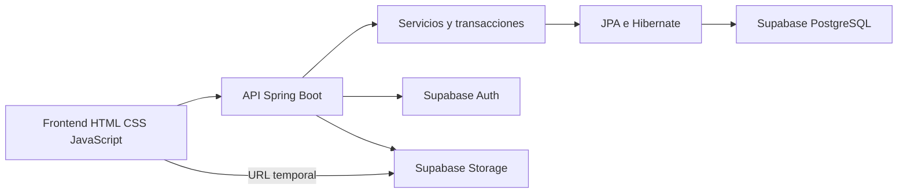
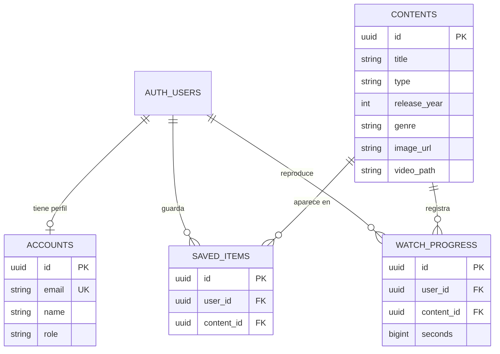

# Arquitectura de Cabaña

La aplicación separa presentación, servicios y persistencia. El navegador consume la API REST de Java. Spring Boot usa Hibernate/JPA para consultar PostgreSQL de Supabase. Supabase Auth emite los JWT reales y Supabase Storage aloja los MP4 privados.

## Modelo conceptual

Un usuario descubre contenidos, guarda favoritos y registra su progreso. El administrador mantiene el catálogo. Los contenidos tienen tipo película o serie, un género, clasificación, portada y una ruta opcional de video. El perfil de usuario está separado de las credenciales, que pertenecen a Supabase Auth.

## Modelo lógico

El modelo físico está en `supabase/01_schema.sql`: tipos, longitudes, claves, restricciones de unicidad, índices, eliminación en cascada y RLS. Género y tipo se guardan como atributos en este MVP. Los UUID de usuario provienen de Supabase Auth; en demo son locales.

## Persistencia y JPQL

`ContentRepository.search` usa JPQL parametrizado para buscar por título y filtrar tipo y género. `genres` consulta géneros distintos. El servicio usa DTO para enviar el catálogo al visitante sin revelar rutas privadas de video.

`CatalogService` declara transacciones de lectura para consultar y transacciones de escritura para crear, editar, eliminar, guardar favoritos y actualizar progreso. La eliminación de un contenido elimina primero sus referencias y después el contenido dentro de una única transacción. Las restricciones únicas previenen favoritos duplicados y más de un progreso para el mismo usuario/contenido.

## Seguridad y roles

| Acción | Visitante | USER | ADMIN |
|---|---|---|---|
| Consultar catálogo y géneros | Sí | Sí | Sí |
| Registro e inicio de sesión | Sí | Sí | Sí |
| Gestionar su lista y progreso | No | Sí | Sí |
| Solicitar reproducción | No | Sí | Sí |
| Crear editar eliminar catálogo | No | No | Sí |

Las rutas privadas requieren un JWT validado. El UUID se extrae del `sub`; nunca se recibe como parámetro para consultar listas de otra persona. Los roles provienen de `cabana.accounts`, no del campo editable `user_metadata`. El frontend puede ocultar botones, pero la autorización real se hace en el servidor.

El acceso se mantiene en memoria del navegador. La renovación usa una cookie HttpOnly y SameSite=Lax; los endpoints de autenticación rechazan un Origin distinto del configurado. CORS admite un único origen configurado. Las contraseñas se procesan por Supabase Auth; en demo se utiliza BCrypt. Las claves de Storage y la contraseña de PostgreSQL son variables exclusivas del servidor.

## Flujo de reproducción

1. El usuario inicia sesión y elige un título.
2. Java valida el token y busca el contenido.
3. Java solicita a Supabase una URL firmada de su archivo privado.
4. El navegador reproduce el MP4 directamente desde Storage.
5. Cada diez segundos y al cerrar el reproductor se guarda la posición.

En demo el paso 3 usa una película libre identificada como muestra. No se entrega un video comercial para los títulos de muestra. El reproductor guarda segundos, sin DRM ni autorización por plan de pago.
