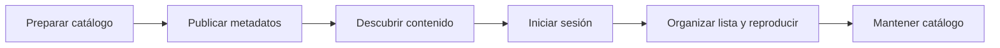
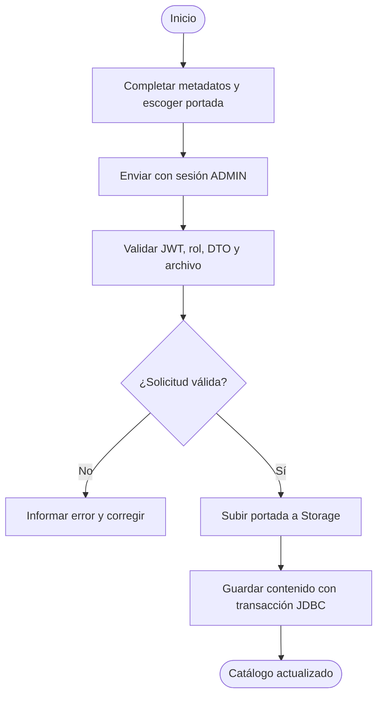
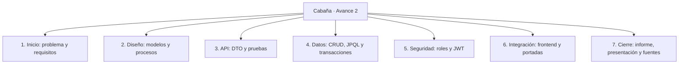
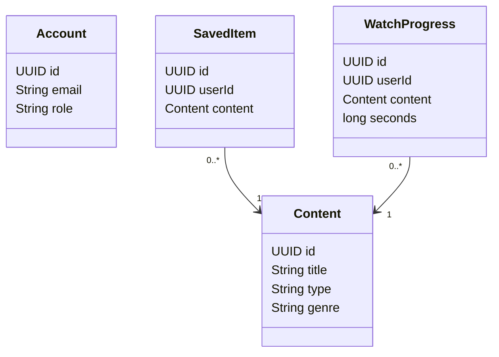

# Diagramas del Avance 2

## Proceso macro propuesto

## Flujo de alta administrativa

La transacción solo afecta a PostgreSQL. Storage necesita compensación y limpieza independientes.

## WBS

## Clases

userId es escalar en Java. Las FK hacia auth.users están en 01_schema.sql. No hay asociación JPA directa Account–SavedItem/WatchProgress.

Visitante: catálogo, detalle, registro y login. USER: lista, progreso y reproducción. ADMIN: operaciones USER más CRUD y portada. Modelos completos de arquitectura y relaciones: [ARQUITECTURA.md](../ARQUITECTURA.md).
